# Seller Desk

**A small shop's own AI sales assistant: it answers customers from the shop's real catalog at any hour, learns what the owner teaches it, and closes the sale with a verified PayPal payment.**

**Who it's for:** any business that takes PayPal and still answers customers by hand, such as a bike repairer, a maker or a tutor. A question that arrives at 9 pm and waits until morning is often a sale lost.

**The one rule:** the AI talks, the server decides money. The assistant answers from the shop's real prices, stock and terms. It cannot invent a price, change a total or mark anything paid. A haggler, a fake "system" message, a tampered amount, a forged webhook and a double payment all end the same way: refused, or one order and one payment.

[Live demo](https://sellerdesk.dev) · [Try the shop](https://sellerdesk.dev/buy) · [How to test it](docs/how-to-test.md) · [How the AI works](#how-the-ai-works) · [How PayPal is used](#how-paypal-is-used) · [Install](#deploy)

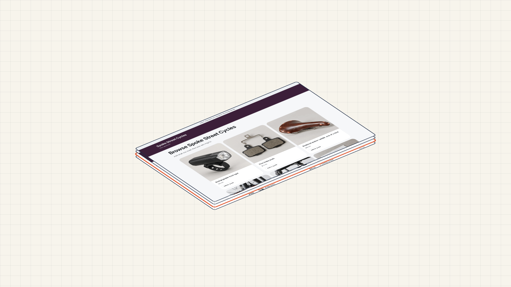

## Try it in 2 minutes

No install. The shop is fictional and payments run in the PayPal sandbox; no real money moves.

1. **Be a customer.** Open the [demo shop](https://sellerdesk.dev/buy) and ask "Can you replace my brake cable by Tuesday?" You get an answer from the shop's catalog and a quote with **Pay with PayPal**.
2. **Be the owner.** On [sellerdesk.dev](https://sellerdesk.dev) press **Look around the owner's desk** (no login, read-only). You see paid orders, customers waiting for an answer, Knowledge, Insights and Setup.
3. **Pay as a sandbox buyer.** The owner login and the PayPal sandbox buyer login are in the submission's private testing field, not in this repository. With them, follow [the 15-minute checklist](docs/how-to-test.md): answer a customer, send a quote, pay it, and watch one order appear.

<!-- Demo film: paste the GitHub-uploaded mp4 URL on its own line here, with a thumbnail linking to the full film on YouTube, once both are published. -->

## How the AI works

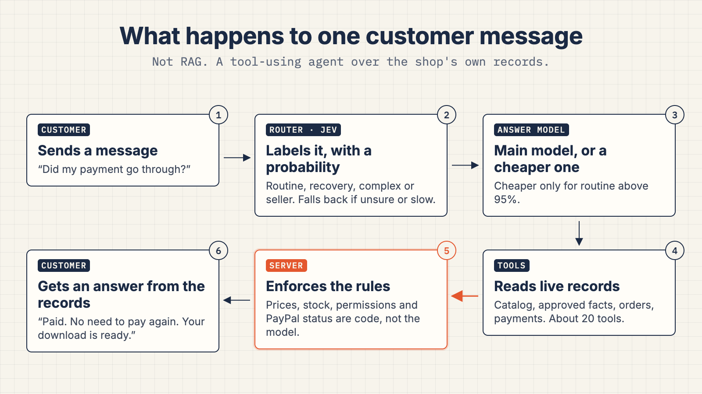

**The shop assistant** is a tool-using agent over the shop's own records, built on Vercel AI SDK 7. There is no RAG, no vector database and no fine-tuning. It reads the catalog, the shop's approved knowledge, its terms and the customer's own orders through tools, and it acts only through tools such as `propose_quote`, `ask_seller` and `restore_download` (`src/server/ai/buyer-tools.ts`). Prices come from the shop, payment status from PayPal, stock and permissions from the database.

**The learning loop.** The assistant gets better from the owner's answers, the way leading support AI products learn from their human agents:

1. **It hands over what it doesn't know.** A customer asks something the shop never told it, such as its hours on New Year's Day. Instead of guessing, the assistant asks the owner (`ask_seller`), and the question waits on the owner's desk.
2. **The assistant drafts the reply.** On the desk the owner presses **Help me write**. It fills the answer box with a reply from the shop's knowledge, terms and catalog. Anything the shop has never said stays as a [bracketed blank] for the owner to fill in, and the desk will not send a reply with a blank left (`src/server/ai/owner-reply.ts`, `src/lib/reply-blanks.ts`).
3. **The owner sends it.** The owner edits or sends the reply, and the customer's conversation picks up again.
4. **Every answer becomes a knowledge draft.** Each answer the owner sends is reviewed automatically against the shop's published facts. The review separates a fact for every customer ("the side entrance is step-free") from a one-off favor ("Isabel can pick up until 18:00 this Friday"), which stays private, and flags conflicts with published terms (`src/server/ai/learning-review.ts`).
5. **The owner approves it once.** In **Knowledge** the owner approves the fact, and can first try it on a typed question to compare the old and new reply. Nothing is published without that approval, and a conflict with the checkout terms or a product listing blocks it.
6. **The next customer gets the answer from the assistant.** No one has to ask the owner again.

This improves the shop's approved knowledge; it does not retrain the model.

<picture>
  <source media="(max-width: 600px)" srcset="docs/media/diagram-learn-mobile.png">
  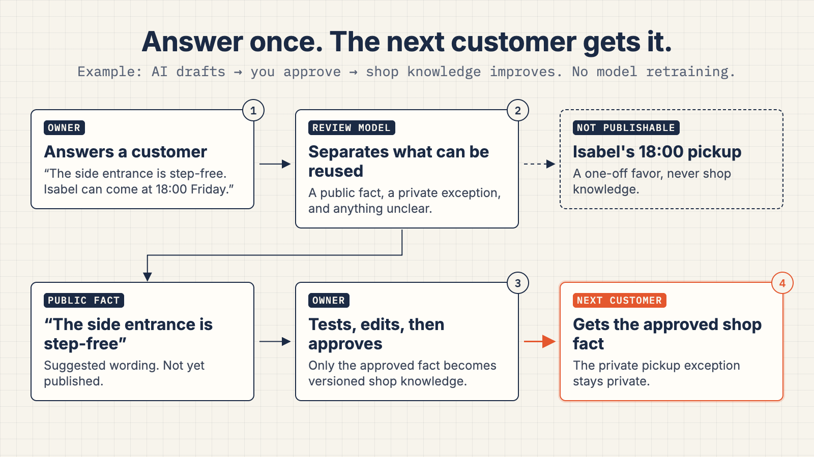
</picture>

**The owner chooses who answers.** In Setup, under "Who answers customers' waiting questions": **Only me**, or **My assistant drafts, I approve**. A separate switch lets the owner's connected AI apps (Claude, ChatGPT and others, through the Seller Desk MCP connector) answer waiting questions as the owner. It is off by default and checked on every call, and those answers go through the same learning review (`src/app/owner/(desk)/setup/answer-settings.tsx`, `src/server/connector/tools.ts`).

**Bring your own AI, with limits.** Each installation is an MCP connector and an Agent Skill for the owner's own AI apps, including Claude Code. They can see who is waiting, read conversations, orders and offers, and answer a waiting question only if the owner turned that on. They can never change prices, stock or orders, and never refund or take payments (`src/lib/connector-scope.ts`).

**Owner Insights** is a dashboard built on AG Studio and AG Grid: what sold, what the assistant handled alone, what is still waiting, and stock. The owner can ask the analyst to explain the figures or add a chart; it uses AG Studio's own Page, Widget and Data agents plus read-only tools for the shop's figures, and shows each step it took. It can read and arrange the dashboard, and has no tool that touches a price, an order or a payment (`src/components/insights/`).

**Owners can also** write standing instructions for the assistant, preview them side by side, publish them and roll back. An optional router may send a routine message to a cheaper model; the label never approves anything, and if the router fails, the main model answers.

## How PayPal is used

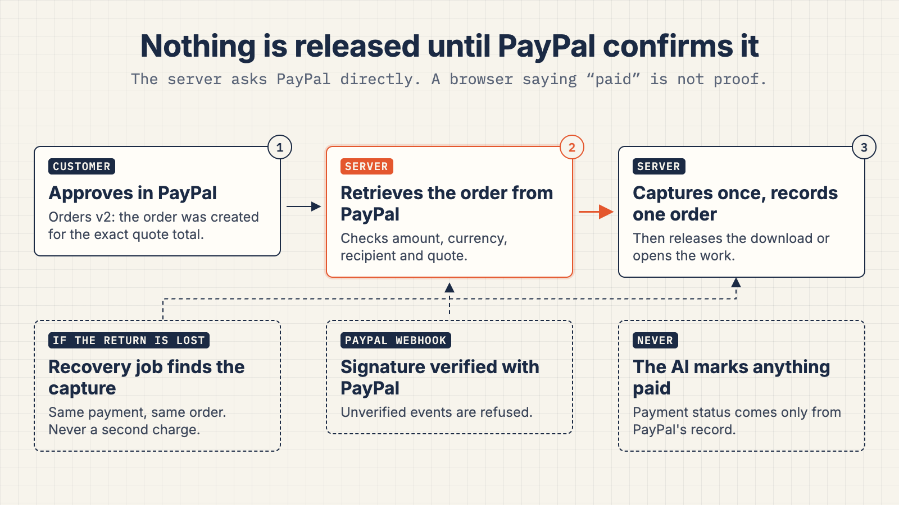

- **Orders v2, server side only.** The server creates and captures the order from a saved quote, never from chat text. Every write carries a `PayPal-Request-Id` saved before the call, so a retry cannot make a second order (`src/server/paypal/live.ts`, `src/server/payments/create-request.ts`).
- **Checked before any order exists.** Before capture, the server retrieves the PayPal order and checks payee, amount and currency against the quote. After capture it checks the capture status is `COMPLETED` and the captured amount matches. Only then is an order or a download released (`src/server/payments/evidence.ts`).
- **A payment state machine.** Each attempt moves through saved states, and a timeout counts as "unknown", never as "failed". The next check asks PayPal first (`src/server/payments/engine.ts`).
- **Verified webhooks and recovery.** Webhooks are checked with PayPal's signature verification; a forged event is refused. A scheduled job finds or completes an interrupted payment and records one order, never a second charge (`src/app/api/paypal/webhook/route.ts`).
- **"I already paid" does nothing.** A customer's claim never creates an order. The assistant can only look up the payment record.
- **One quote, one payment.** A quote that is being paid cannot be paid again. Buying again makes a new quote and leaves the paid order alone (`src/server/domain/quotes.ts`).
- **PayPal Agent Toolkit, read-only, for the owner.** With `PAYPAL_AGENT_TOOLKIT=on`, the owner's desk assistant can ask PayPal "what does PayPal say about order 1006?" or "any open disputes?". The toolkit is configured with read actions only, and its tools are checked against a fixed list before the model sees them. Moving money stays in the server's own code (`src/server/paypal/agent-toolkit.ts`).

| Step | PayPal call | What the server does around it |
|---|---|---|
| Sign in to PayPal | `POST /v1/oauth2/token` | Client credentials stay on the server |
| Start checkout | `POST /v2/checkout/orders` | Amount comes from the saved quote, never from the chat. A `PayPal-Request-Id` saved before the call makes a retry safe |
| Customer returns | `GET /v2/checkout/orders/{id}` | Payee, amount and currency must match the quote before anything else happens |
| Take the money | `POST /v2/checkout/orders/{id}/capture` | Captured once. Paying twice or reloading still ends in one order |
| Backup | Webhook, checked with `POST /v1/notifications/verify-webhook-signature` | An unsigned or forged event is refused. A lost return page is recovered by a scheduled job |
| Owner lookups (optional) | PayPal Agent Toolkit: `get_order`, `list_transactions`, `list_invoices`, `get_invoice`, `list_disputes`, `get_dispute` | Read-only, for the owner's desk assistant |

## Architecture

- **One Next.js 16 app** for the shop, the owner's desk, the checkout and the connector.
- **Two hosts, one codebase:** Cloudflare Workers with D1, or Node with PostgreSQL (Vercel, or `pnpm demo` on your machine). Drizzle ORM covers both databases.
- **AI:** Vercel AI SDK 7 with Claude, or any OpenAI, Google or gateway model. The provider key stays on the server.
- **Shop tests** run the real assistant in a separate, throwaway copy of the shop, so they never touch real orders.
- **Open source, MIT.** A WordPress plugin or one script tag puts the assistant on an existing website.

## See it work

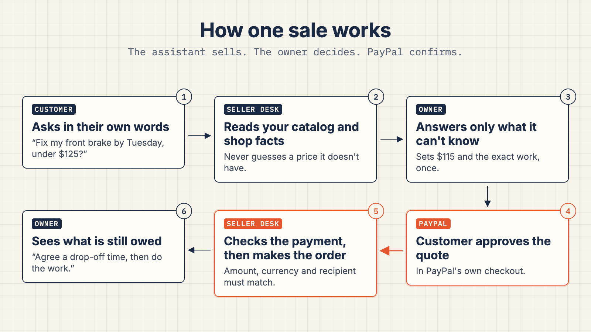

**1. The customer asks.** A product, a custom repair, a budget or a deadline. The assistant reads
your catalog and brings you the question it can't answer from your published information.
Customers can also browse and build a quote directly.

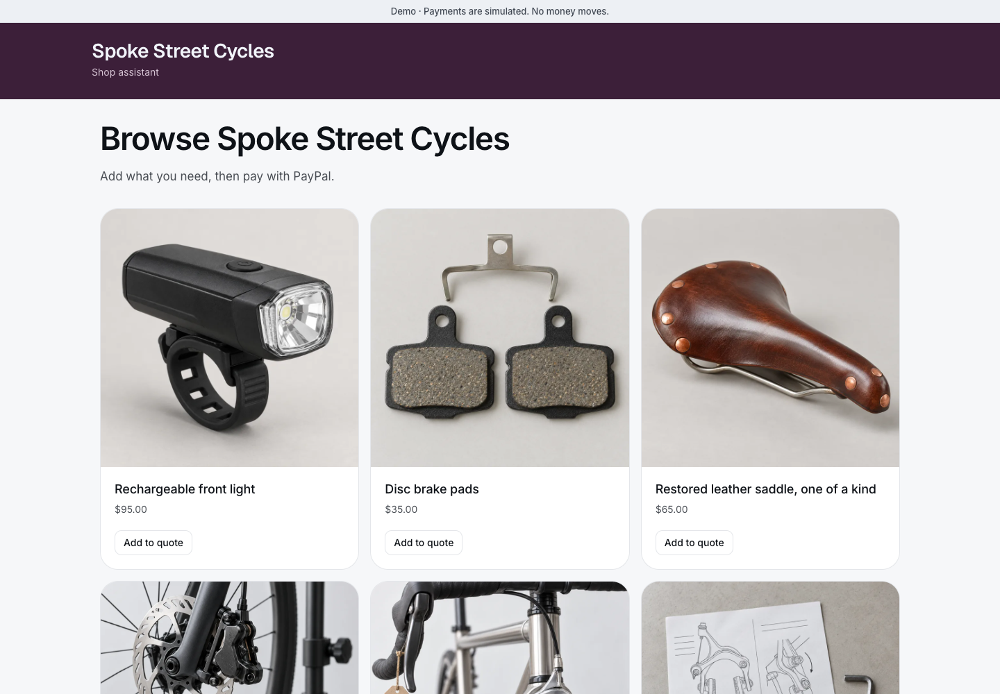

**2. You control the quote.** Prices come from your catalog or your reviewed service quote.
The customer sees the scope, quantity and total before paying.

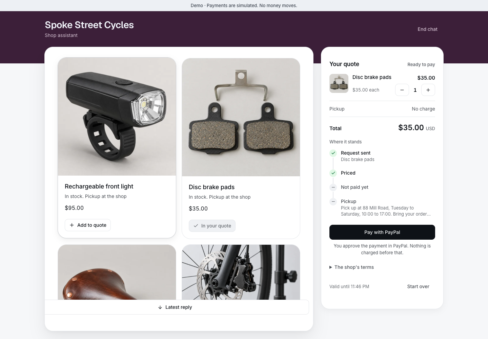

**3. PayPal takes the payment.** The server checks it before creating the order. Paid is not done:
the appointment time and the work stay open until you finish them.

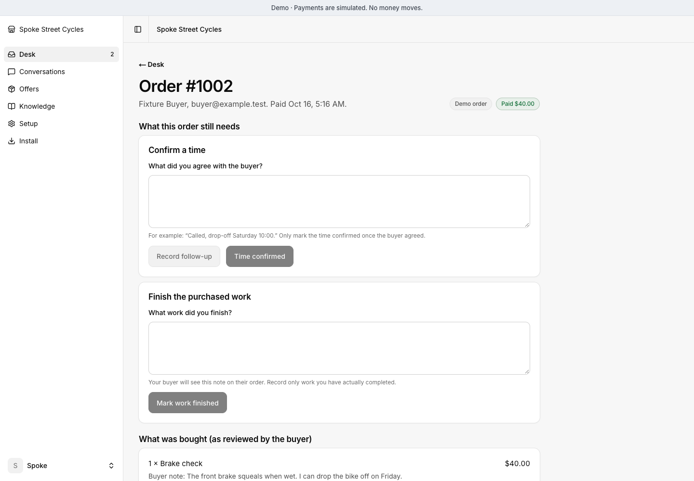

**4. You see what needs you.** Questions, pickups, service work and payments to check stay
visible in one desk, with the orders in an AG Grid table you can sort, search and export. The
desk assistant can read order records when you ask what needs attention.

<picture>
  <source media="(max-width: 600px)" srcset="docs/media/seller-desk-mobile.png">
  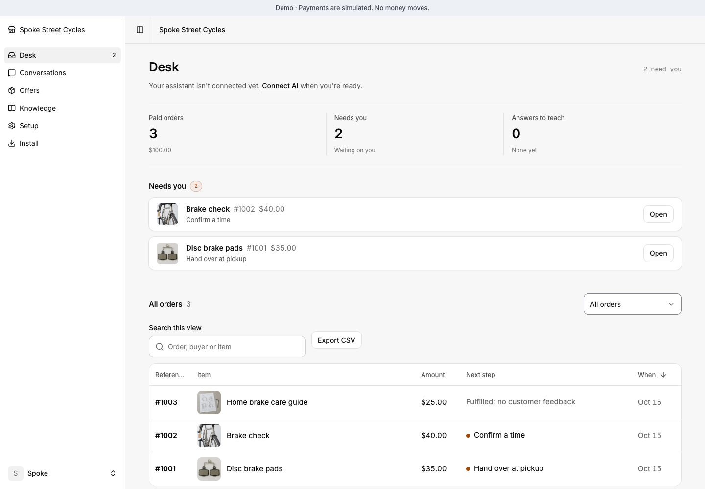
</picture>

**“Did my payment go through?”** The assistant checks the payment record. It can recover a
valid download without creating a second charge. See [payment recovery](docs/proof-matrix.md).


## Works with the shop you already have

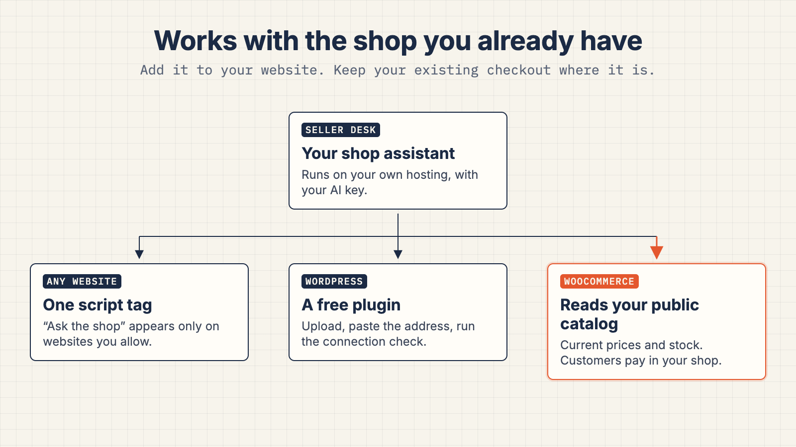

- **Any website.** Paste one script tag. The "Ask the shop" button appears only on websites
  you allow.
- **WordPress.** Download the free plugin from the desk, upload it, paste your Seller Desk
  address and run its connection check. No theme editing.
- **WooCommerce.** Point Seller Desk at your store. The assistant searches your public catalog
  for current prices, stock and options, and sends customers to your product page; checkout,
  shipping and refunds stay in your shop. No admin key needed.
- **Your own pages.** Add your booking page or returns form to the shop's knowledge, and the
  assistant can offer it as a button.

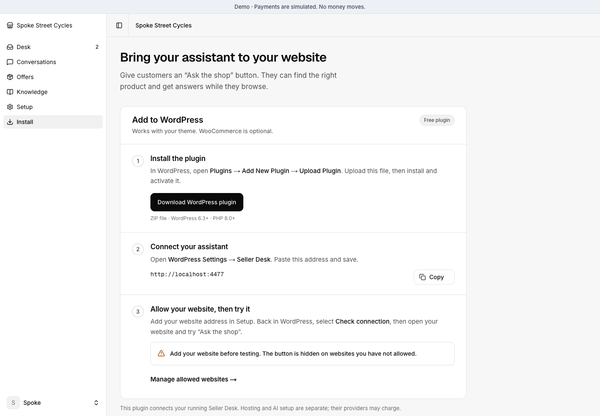

## Try the hard questions before customers do

In your desk, open **Knowledge → Test your assistant**. Try a product question,
an impossible deadline or a longer conversation. Add a seller reply, approve a
service scope or authorize an exact fictional purchase. Ask it to recover a lost
payment response, then check that there is one payment and one order. Or let a
simulated customer play a part: a haggler, a buyer pasting fake system text, a
firm budget and more, written by your model from your own offers. Every test
then checks that quotes kept your published prices and stayed within stock.

The test uses your real connected model and published shop facts in a separate
fictional shop. Compare published instructions with a saved change before you
publish it. Read the actual conversation, actions and database outcomes. A finished
run is not automatically a pass, and the expectation you write never reaches the
model. Your live stock, customers and orders stay untouched.

[How seller tests work](docs/seller-tests.md)

## What is real and what is simulated

| | Hosted demo | `pnpm demo` on your machine |
|---|---|---|
| AI answers | Real model | Real model if you add a key; plain catalog without |
| PayPal | Real PayPal sandbox | A built-in stand-in, no account needed |
| Shop and customers | Fictional | Fictional |
| "Test your assistant" | Real model, throwaway copy of the shop | Same |

## Try it locally

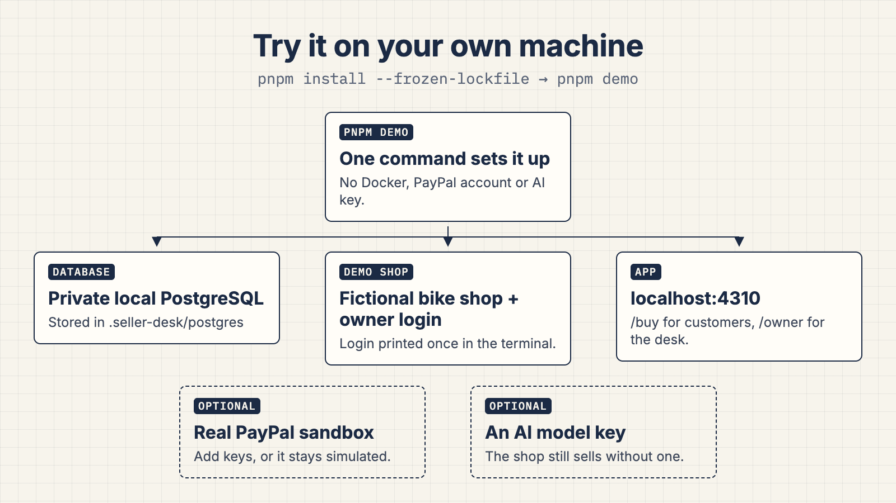

Needs Node 24+ and pnpm 10.2.1.

```sh
pnpm install --frozen-lockfile
pnpm demo
```

This creates a private local database and a fictional shop, then prints the shop
address and an owner login. Without an AI key the shop still sells; connect a model with
the [AI guide](docs/ai-activation.md).

For a local **Cloudflare D1** installation instead of PostgreSQL:

```sh
pnpm demo:d1
```

This keeps its own fictional database and private owner login. See the
[database guide](docs/database-portability.md). Both demos preserve existing records.
AI requires a provider key; installation never invents assistant replies.

## Deploy

Install in your own account. Choose one host:

[](https://vercel.com/new/clone?repository-url=https%3A%2F%2Fgithub.com%2Foguzserdar%2Fseller-desk&project-name=seller-desk&repository-name=seller-desk&env=APP_MODE%2CDATABASE_KIND%2CBETTER_AUTH_SECRET%2CJOBS_SECRET%2CINSTALL_TOKEN%2CENABLE_EXPERIMENTAL_COREPACK&envDefaults=%7B%22APP_MODE%22%3A%22sandbox%22%2C%22DATABASE_KIND%22%3A%22postgres%22%2C%22ENABLE_EXPERIMENTAL_COREPACK%22%3A%221%22%7D&envDescription=Create+a+separate+Neon+PostgreSQL+database+in+the+installation+flow.+Supply+three+different+random+secrets+of+at+least+32+characters.+After+deployment%2C+create+the+owner+at+%2Fowner%2Fstart.+AI+and+PayPal+connect+afterward.&envLink=https%3A%2F%2Fgithub.com%2Foguzserdar%2Fseller-desk%2Fblob%2Fmain%2Fdocs%2Fdeploy-vercel.md&products=%5B%7B%22type%22%3A%22integration%22%2C%22protocol%22%3A%22storage%22%2C%22productSlug%22%3A%22neon%22%2C%22integrationSlug%22%3A%22neon%22%7D%5D)
[](https://deploy.workers.cloudflare.com/?url=https%3A%2F%2Fgithub.com%2Foguzserdar%2Fseller-desk)

- **Vercel:** a separate Neon PostgreSQL database. [Installation guide](docs/deploy-vercel.md).
- **Cloudflare:** a separate D1 database, with scheduled payment recovery included. [Installation guide](docs/deploy-cloudflare.md).

Both prepare the database and open protected owner setup. Connect your AI provider and
PayPal account afterward; credentials stay on your server. Vercel also needs a frequent
recovery scheduler. Hosting, AI usage and payment processing have separate costs.
See [installation readiness](docs/readiness.md) for the checks still required.

<!-- Publication candidate: publish reviewed public source and verify each hosted installer before claiming end-to-end installation. -->

## Docs

- [Full guide](docs/guide.md): settings, WordPress, WooCommerce, PayPal sandbox and the rules the server enforces
- [How to test it](docs/how-to-test.md): a 15-minute checklist with expected results
- [What works today](docs/readiness.md) and the [verification record](docs/proof-matrix.md)

## Status

A hackathon build. Local demos use simulated payments; the hosted demo uses PayPal sandbox.
AI conversations need a configured provider. UI screenshots show the current app with fictional
shop data and simulated local purchases; explanatory diagrams are examples, not transcripts.

Checkout covers pickup goods, quoted services and small downloads. Shipping, refunds and
booking stay in your existing tools. See [what works today](docs/readiness.md) and the
[verification record](docs/proof-matrix.md) for completed checks and unfinished work.

## Built with

PayPal Orders v2, PayPal webhooks and PayPal's Agent Toolkit · Vercel AI SDK 7 with Claude
(Anthropic), and any OpenAI, Google or gateway model · Model Context Protocol and Agent Skills ·
Next.js 16 and React · AG Studio and AG Grid Community · Drizzle ORM on Cloudflare D1 or PostgreSQL · Better
Auth · Cloudflare Workers or Vercel.

Built for the PayPal AI Hackathon 2026. Not made by or affiliated with PayPal.

## License

[MIT](LICENSE). Third-party components keep their own licenses; see
[the notices](THIRD_PARTY_NOTICES.md).
