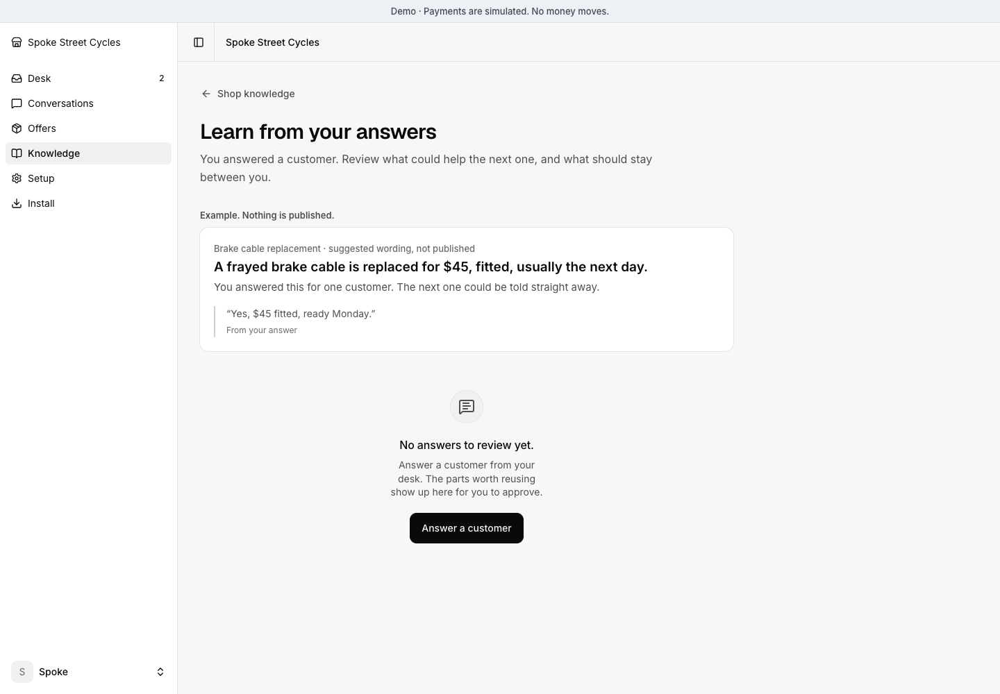

# Seller Desk

**The open-source AI sales assistant for PayPal sellers.**

It answers customers from your catalog, asks you only what it can't know, and closes the sale with a verified PayPal payment.

[Demo](https://seller-desk.oguz-077.workers.dev/buy) · [How it learns](#it-learns-from-the-answers-you-give) · [Install](#deploy) · [Guide](docs/guide.md)


## See it work


<!-- Demo film: paste the GitHub-uploaded mp4 URL on its own line here, with a thumbnail linking to the full film on YouTube, once both are published. -->

**1. The customer asks.** A product, a custom repair, a budget or a deadline. The assistant reads
your catalog and brings you the question it can't answer from your published information.
Customers can also browse and build a quote directly.


**2. You control the quote.** Prices come from your catalog or your reviewed service quote.
The customer sees the scope, quantity and total before paying.


**3. PayPal takes the payment.** The server checks it before creating the order. Paid is not done:
the appointment time and the work stay open until you finish them.


**4. You see what needs you.** Questions, pickups, service work and payments to check stay
visible in one desk. The desk assistant can read order records when you ask what needs attention.

<picture>
  <source media="(max-width: 600px)" srcset="docs/media/seller-desk-mobile.png">
  
</picture>

**“Did my payment go through?”** The assistant checks the payment record. It can recover a
valid download without creating a second charge. See [payment recovery](docs/proof-matrix.md).

## Works with the shop you already have


- **Any website.** Paste one script tag. The "Ask the shop" button appears only on websites
  you allow.
- **WordPress.** Download the free plugin from the desk, upload it, paste your Seller Desk
  address and run its connection check. No theme editing.
- **WooCommerce.** Point Seller Desk at your store. The assistant searches your public catalog
  for current prices, stock and options, and sends customers to your product page; checkout,
  shipping and refunds stay in your shop. No admin key needed.
- **Your own pages.** Add your booking page or returns form to the shop's knowledge, and the
  assistant can offer it as a button.


## It learns from the answers you give

<picture>
  <source media="(max-width: 600px)" srcset="docs/media/diagram-learn-mobile.png">
  
</picture>



This improves the shop's approved knowledge; it does not retrain the model.

When the shop answers a customer's question, the owner can press **Review this answer**. A
review model reads that question and answer next to the shop's published facts, terms and
products, and drafts:

- **a fact for everyone**, such as "the side entrance is step-free", in public wording;
- **a one-off favor**, such as "Isabel can pick up until 18:00 this Friday", marked as not
  publishable;
- **open questions and conflicts** with rules the shop already published.

Nothing goes public until the owner approves it. A conflict with the checkout terms or a
product listing blocks publishing. Each approved fact is versioned and linked to the review it
came from, and the owner can first try it on a typed customer question to compare the old and
new reply. The next customer then gets the answer without the shop being asked again.

Owners can also write standing instructions for the assistant, preview them side by side,
publish them and roll back to an earlier version.

## Try the hard questions before customers do

In your desk, open **Knowledge → Test your assistant**. Try a product question,
an impossible deadline or a longer conversation. Add a seller reply, approve a
service scope or authorize an exact fictional purchase. Ask it to recover a lost
payment response, then check that there is one payment and one order.

The test uses your real connected model and published shop facts in a separate
fictional shop. Compare published instructions with a saved change before you
publish it. Read the actual conversation, actions and database outcomes. A finished
run is not automatically a pass, and the expectation you write never reaches the
model. Your live stock, customers and orders stay untouched.

[How seller tests work](docs/seller-tests.md)

## How it uses PayPal and AI


**What the AI is.** A tool-using agent over the shop's own records. There is no RAG, no vector
database and no fine-tuning. For every message:

1. **Router (optional).** Jev or OpenAI Decisions labels the message as routine, recovery,
   complex or a request for the seller, with probabilities. Optional Haiku classification supplies
   the same handling categories without probability-based answer-model switching. Only a routine label above 95% may
   switch the turn to a cheaper model. The label never approves anything, and if the router
   fails or takes over 2.5 seconds, the main model answers.
2. **Answer model with tools.** AI SDK 7 connects to Vercel AI Gateway, OpenRouter or a native
   provider such as Anthropic or OpenAI. Your chosen reply model reads live data through tools: the catalog (given whole up to 40 offers,
   searched by words above that), the shop's approved facts, the customer's orders and
   payments. It acts only through tools such as `propose_quote`, `ask_seller` and
   `restore_download`.
3. **The server decides.** Prices come from the shop, payment status from PayPal, stock and
   permissions from the database. The model cannot set a price or mark anything paid.

The learning review above is a separate, owner-triggered model call with a structured answer.


**PayPal.** Checkout uses the Orders v2 API: create, retrieve and capture. Before an order or a
download is released, the server retrieves the PayPal order itself and checks the amount,
currency and recipient. Webhooks are verified with PayPal's signature check. If a customer's
return is interrupted, a recovery job finds or completes the payment and records one order,
never a second charge.

## Try it locally


Needs Node 24+ and pnpm 10.2.1.

```sh
pnpm install --frozen-lockfile
pnpm demo
```

This creates a private local database and a fictional shop, then prints the shop
address and an owner login. Without an AI key the shop still sells; connect a model with
the [AI guide](docs/ai-activation.md).

For a local **Cloudflare D1** installation instead of PostgreSQL:

```sh
pnpm demo:d1
```

This keeps its own fictional database and private owner login. See the
[database guide](docs/database-portability.md). Both demos preserve existing records.
AI requires a provider key; installation never invents assistant replies.

## Deploy

Install in your own account. Choose one host:

[](https://vercel.com/new/clone?repository-url=https%3A%2F%2Fgithub.com%2Foguzserdar%2Fseller-desk&project-name=seller-desk&repository-name=seller-desk&env=APP_MODE%2CDATABASE_KIND%2CBETTER_AUTH_SECRET%2CJOBS_SECRET%2CINSTALL_TOKEN%2CENABLE_EXPERIMENTAL_COREPACK&envDefaults=%7B%22APP_MODE%22%3A%22sandbox%22%2C%22DATABASE_KIND%22%3A%22postgres%22%2C%22ENABLE_EXPERIMENTAL_COREPACK%22%3A%221%22%7D&envDescription=Create+a+separate+Neon+PostgreSQL+database+in+the+installation+flow.+Supply+three+different+random+secrets+of+at+least+32+characters.+After+deployment%2C+create+the+owner+at+%2Fowner%2Fstart.+AI+and+PayPal+connect+afterward.&envLink=https%3A%2F%2Fgithub.com%2Foguzserdar%2Fseller-desk%2Fblob%2Fmain%2Fdocs%2Fdeploy-vercel.md&products=%5B%7B%22type%22%3A%22integration%22%2C%22protocol%22%3A%22storage%22%2C%22productSlug%22%3A%22neon%22%2C%22integrationSlug%22%3A%22neon%22%7D%5D)
[](https://deploy.workers.cloudflare.com/?url=https%3A%2F%2Fgithub.com%2Foguzserdar%2Fseller-desk)

- **Vercel:** a separate Neon PostgreSQL database. [Installation guide](docs/deploy-vercel.md).
- **Cloudflare:** a separate D1 database, with scheduled payment recovery included. [Installation guide](docs/deploy-cloudflare.md).

Both prepare the database and open protected owner setup. Connect your AI provider and
PayPal account afterward; credentials stay on your server. Vercel also needs a frequent
recovery scheduler. Hosting, AI usage and payment processing have separate costs.
See [installation readiness](docs/readiness.md) for the checks still required.

<!-- Publication candidate: publish reviewed public source and verify each hosted installer before claiming end-to-end installation. -->

## Docs

- [Full guide](docs/guide.md): settings, WordPress, WooCommerce, PayPal sandbox and the rules the server enforces
- [How to test it](docs/how-to-test.md): a 15-minute checklist with expected results
- [What works today](docs/readiness.md) and the [verification record](docs/proof-matrix.md)

## Status

A hackathon build. Local demos use simulated payments; the hosted demo uses PayPal sandbox.
AI conversations need a configured provider. UI screenshots show the current app with fictional
shop data and simulated local purchases; explanatory diagrams are examples, not transcripts.

Checkout covers pickup goods, quoted services and small downloads. Shipping, refunds and
booking stay in your existing tools. See [what works today](docs/readiness.md) and the
[verification record](docs/proof-matrix.md) for completed checks and unfinished work.

## License

[MIT](LICENSE). Third-party components keep their own licenses; see
[the notices](THIRD_PARTY_NOTICES.md).
