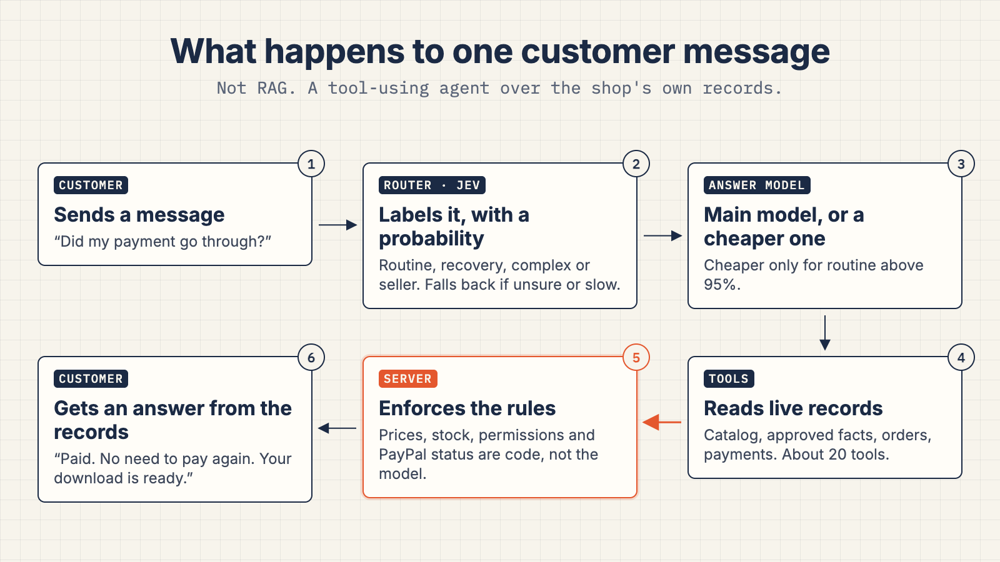
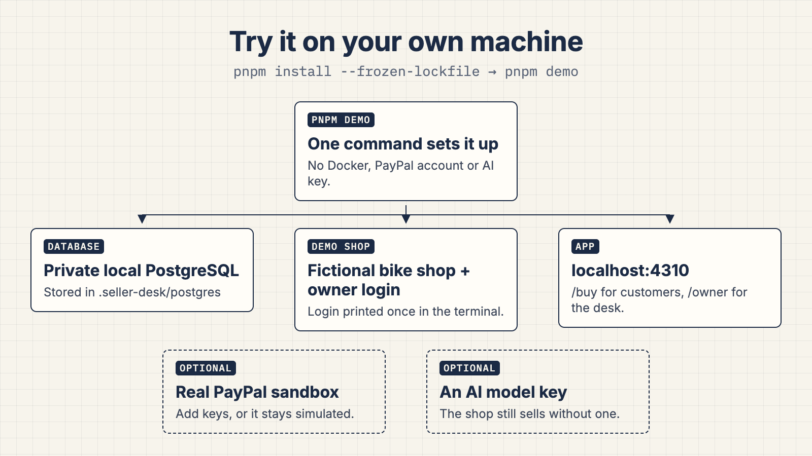
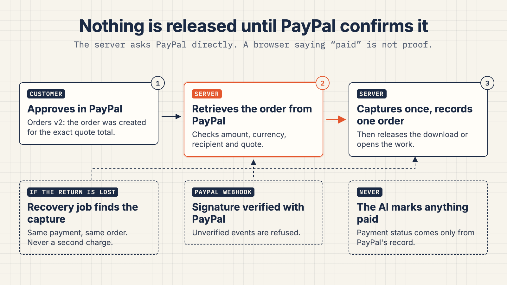
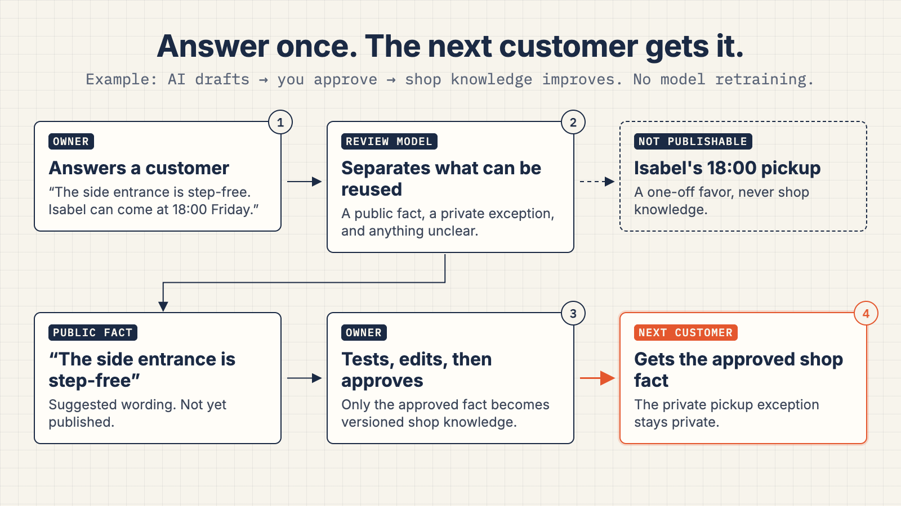

# Seller Desk: full guide

The [README](../README.md) is the short version. This page keeps every detail.

**An open-source AI sales agent that takes customers from a question to a PayPal purchase and helps sellers handle what comes next.**

Customers ask about products, describe a service or find a download. Seller Desk
reads the seller's published catalog and policies, builds a priced quote, and
asks the seller when information or a decision is missing. The customer approves
checkout in PayPal. The server verifies payment before creating a paid order or
releasing a download.

For native Cloudflare D1 installation and database boundaries, see the [database guide](database-portability.md).

## What you can do



- **Answer from your shop:** real AI uses published offers and approved knowledge.
- **Quote goods and services:** revise quantities, collect service details and send a seller-reviewed price.
- **Take PayPal payments:** verify the amount, currency and recipient; recover an interrupted payment check.
- **Deliver purchased files:** provide small digital downloads and recover still-valid access without charging again.
- **Run the seller desk:** review orders, send a service quote and customer answer together, and approve supported actions explicitly.
- **Keep paid work visible:** agreeing a service time leaves the purchased work open; record completion with a note the buyer can read.
- **Keep a problem with its order:** the buyer sends feedback from their receipt, the shop replies, and the buyer confirms or reopens it. Payment and delivery stay separate.
- **Answer once:** review a saved seller answer and approve its reusable facts for future customers; keep customer exceptions private.
- **Add it to your site:** embed the widget in WordPress or another website; optionally search a public WooCommerce catalog.

Native checkout supports pickup goods, fixed-price or individually quoted
services, and digital files up to 1 MiB. Shipping, variants, subscriptions,
refunds and appointment booking stay in your existing systems. Seller Desk does
not import your existing PayPal order history.

Free MIT source. AI usage, hosting and PayPal fees are separate. WordPress installs
the widget; the Seller Desk backend still needs to run somewhere.

## Start a local shop



Install Node 24 or newer and pnpm 10.2.1, then run:

```sh
pnpm install --frozen-lockfile
pnpm demo
```

A fresh checkout creates its own private local PostgreSQL database, writes private settings, applies migrations, seeds a fictional shop, and starts the app and recovery worker. No Docker, existing PostgreSQL installation, PayPal account or AI key is required to browse and exercise simulated checkout. The local database is a development dependency and runs only on your computer.

Open [the shop](http://localhost:4310/buy) or [the owner desk](http://localhost:4310/owner/login). The first run prints a generated demo owner login. Stop with Ctrl+C; run `pnpm demo` again to reopen the same shop. Data stays in `.seller-desk/postgres`, with secrets in `.env.local`. Both are excluded from source releases.

**There are no scripted AI replies.** Without a real model connection, chat and AI-assisted drafting stay disconnected. Manual browsing, quotes, simulated checkout and order management work. Model usage may cost money even though the source is free.

Options:

- `pnpm demo --port 4410` chooses a different app port on a fresh checkout.
- `pnpm demo --setup-only` initializes the shop and stops. Run `pnpm demo` to start it.
- `pnpm demo --database-url 'postgresql://...'` uses your own empty database on a fresh checkout.
- Existing `.env.local` is preserved. Edit it to change an existing installation.
- `pnpm run doctor` checks the running installation without sending model requests.
- `pnpm example:site` opens a sample merchant site on port 4311. Its widget uses the shop on port 4310. Pass `--desk http://localhost:4410` for a different shop address.

## Current release status

This is a hackathon build. As of 13 October 2026:

- **Real AI journeys.** Four scripted journeys pass against a real model
  (`openai/gpt-5-mini` through Vercel AI Gateway). They call the app's real route
  handlers without a browser and use the demo PayPal step; the replies were read and
  reviewed by hand:
  a goods purchase, a digital download with payment recovery, a custom service the
  shop prices before payment, and the shop learning from one answer while keeping a
  one-customer promise private. Evidence is written by `pnpm eval:journey`.
- **Demo film.** A 2:37 film of those stories, plus the owner's desk and the widget on a shop's own website,, filmed in the running app with the real
  model, is rendered. Every cut inside a recording is labelled on screen with the time
  removed, and a switch between the customer's and the owner's screen says whose screen
  it is. The public link is added at submission.
- **PayPal.** Sandbox payment and recovery have been checked against PayPal's sandbox.
  The film and the default local setup use the built-in demo PayPal page, which says on
  screen that no money moves.
- **Tests.** 549 automated tests pass (`pnpm test`).
- **Not yet available:** a hosted demo for judges. Until it exists, the app runs locally
  (below). Without an AI key the shop still works: products go straight into the quote
  and checkout, and only the assistant is off.

Read the [working and unfinished checklist](readiness.md),
[verification record](proof-matrix.md), and
[how to test it](how-to-test.md).

## Deploy it

[Deploy on Vercel with PostgreSQL](deploy-vercel.md), or [deploy on Cloudflare Workers with native D1 or PostgreSQL](deploy-cloudflare.md). Each installation uses its own database, owner login and private settings.

Seller Desk runs on Vercel or on Cloudflare Workers from the same source. Both need a
PostgreSQL database reachable over TLS (for example Neon), an HTTPS address, and the
settings listed in `.env.example`. Use an empty database for each installation.

**Vercel** ([full guide](deploy-vercel.md))

1. Create the database, then from your computer run `pnpm db:migrate` and
   `pnpm owner:bootstrap` against it. Keep the printed owner login private.
2. Import the repository as a Next.js project (Node 24+, pnpm 10.2.1, build command
   `pnpm build`) and add the settings from `.env.example`. `APP_URL` is the final
   HTTPS address.
3. On Vercel, the app reaches AI Gateway through the deployment's own identity, so
   `AI_GATEWAY_API_KEY` is optional there.
4. Point the PayPal sandbox webhook at `https://YOUR-ADDRESS/api/paypal/webhook`, and
   schedule `/api/jobs/reconcile` with `Authorization: Bearer <JOBS_SECRET>` (Vercel
   Cron sends `CRON_SECRET`, so set it to the same value).

**Cloudflare Workers** ([full guide](deploy-cloudflare.md))

1. Create the database and run `pnpm db:migrate` and `pnpm owner:bootstrap` as above.
2. Put the settings in a private `.dev.vars`, then `pnpm build:cloudflare`. The build
   lists the secret names the Worker needs; set each as an encrypted Worker secret.
   AI Gateway needs `AI_GATEWAY_API_KEY` here.
3. `pnpm deploy:cloudflare` publishes the Worker. Its own schedule runs recovery every
   minute (tested locally; not yet proven on a hosted Worker).
4. Point the PayPal sandbox webhook at the Worker's address as above.

Status on 13 October: the Vercel build deploys to a protected preview without a
database; the Cloudflare build and local Workers runtime pass; neither has a hosted
database or a public address yet.

## Use it alongside your existing business

Open **Owner → Knowledge**. Add a focused policy or product explanation, optionally add your public booking page, product options, returns form or customer portal, and review **Approved for customer answers** before publishing. Drafts stay private. Do not paste customer details, secrets or private access links into public knowledge.

The real model reads these facts and selects a relevant next step. Its reply shows the sources it read. Buttons come only from published owner records; the model cannot supply an arbitrary destination. Editing, unpublishing or removing an entry invalidates its old buttons. An updated link gives the customer a path back to the conversation.

Keep the guide to 24 entries, up to 2,000 characters each. This version reads the bounded guide in full. It does not crawl websites, sync policies, provide large-scale retrieval, check a remote calendar, or verify an outside purchase. Your existing checkout still handles its own variants, tax, shipping, subscriptions and file delivery. Native Seller Desk checkout keeps its separate server-priced quote and PayPal verification.

## Connect a current WooCommerce catalog

Set `WOO_STORE_URL=https://your-shop.example` in your private `.env.local` or hosting environment, using the WordPress installation address (include its subdirectory if it has one). Restart Seller Desk. Open **Owner → Install → Check store connection**. This public product connection needs no WooCommerce admin key.

The real assistant searches the Store API on demand and can read one product again. Cards show the store's current price or price range, reported stock and whether options are required. HTML is converted to plain text. The search returns eight records per page; the model can change search terms or request another page. Results are snapshots, not stock reservations. Product buttons recheck the current product and configured store before opening its page. Withdrawing a product or replacing the connection invalidates old destinations.

Checkout, shipping, taxes and option selection stay in the existing shop. Connected products cannot enter Seller Desk's local quotes. The connector does not reserve stock, access external orders, issue refunds or establish that PayPal is enabled on that store. When the API fails, the assistant reports that prices and stock are unverified instead of treating previous results as current. Password-protected products and unsafe links are omitted.

The deployment operator controls this outbound destination. Customers, models and imported content cannot change it. Production addresses must use public HTTPS; HTTP loopback is permitted only in fixture mode for a local test store. Remote redirects are refused, reads have a ten-second timeout and a 256 KB response cap, and no cookies or authorization credentials are forwarded. DNS and network access to the selected operator-managed destination remain the host operator's responsibility.

## Install the widget in WordPress


Open **Seller Desk → Install → Download WordPress plugin**. In WordPress, open **Plugins → Add Plugin → Upload Plugin**, upload the ZIP and activate it. Under **Settings → Seller Desk**, save your running Seller Desk address. Add the exact storefront address shown there to **Seller Desk → Setup → Allowed websites**. Run the plugin's connection check, then open the storefront and select **Ask the shop**.

No theme editing, PayPal key or AI key is needed in WordPress. This installs the widget, not its hosting or AI backend. WooCommerce is optional; its public product connection is configured separately as described above. The plugin does not connect customer accounts or existing orders. Clearing the address or deactivating the plugin removes it; clear any page/CDN cache too.

The original MIT plugin source is in `integrations/wordpress/seller-desk-widget`. The downloadable ZIP contains only its PHP, settings script/styles, readme and license. Rebuild with `pnpm package:wordpress`; the app tests check that the archive matches those sources. PHP validation/isolation checks can be run separately with `php tests/wordpress/plugin-test.php` (PHP 8.0+). WordPress 6.3+ is required. Local verification used WordPress 7.0.7, WooCommerce 11.2.0 and PHP 8.3.33.

The plugin uses the native [WordPress Settings API](https://developer.wordpress.org/plugins/settings/settings-api/) for configuration permissions and CSRF checks. It accepts an exact HTTPS origin. HTTP loopback is available only when the WordPress site itself uses a loopback host. A failed connection check explains the next step; it does not certify model or payment readiness.

## Connect a real AI model

A fresh `pnpm demo` prepares Jev decisions and Sonnet replies through Vercel AI Gateway. Add `AI_GATEWAY_API_KEY` to its private `.env.local`, then restart. Existing settings are preserved. **Owner → Setup → Connect your assistant** generates settings for Gateway, OpenRouter or a native provider. All work with fixture or PayPal sandbox mode. AI usage is billed by the provider; installing the source is free.

| Provider | AI_PROVIDER | Key |
| --- | --- | --- |
| Vercel AI Gateway | gateway | AI_GATEWAY_API_KEY, or deployment OIDC on Vercel |
| OpenRouter | openrouter | OPENROUTER_API_KEY |
| OpenAI | openai | OPENAI_API_KEY |
| Anthropic | anthropic | ANTHROPIC_API_KEY |
| Google | google | GOOGLE_GENERATIVE_AI_API_KEY |

Use a model available in your account that supports tools and structured output. Gateway and OpenRouter use one key for Jev and replies. Direct Anthropic, OpenAI or Google replies can pair with `AI_ROUTING_PROVIDER=typesafe` and `TYPESAFE_AI_API_KEY`; use `AI_ROUTING_PROVIDER=off` to let the reply model handle every turn directly. No Haiku or second reply model is required.

Jev provides an advisory handling label before the reply. If it fails, takes over 2.5 seconds, or its selected-option probability is below 0.95, the main reply model handles the turn. This threshold is a starting configuration, not a measured accuracy guarantee. Authentication, tool permissions, prices, PayPal verification and explicit approvals remain server rules. Cancellation stops the turn; the app never inserts a canned successful reply.

Optionally set `AI_ROUTINE_MODEL_ID` to a cheaper model you have tested. `AI_ROUTINE_PROVIDER` defaults to the reply provider. Only a high-probability routine decision selects it; recovery, complex requests and seller-answer continuations use the main model. Its failure is shown honestly, with no automatic second attempt after tools may have run. Native adapters are in `src/server/ai/registry.ts` and decision adapters in `src/server/ai/routing.ts`; another AI SDK provider requires an explicit adapter/configuration change.

In **Owner → Setup**, use **Check AI connection**, or run `pnpm run doctor -- --live`. It checks every enabled connection sequentially, up to five small requests. Reply models must read a random value through a read-only tool and return it in structured output. Jev must return a valid choice and probability. The check uses no shop data and creates no commerce actions. Setup stores proof bound to the current settings and credentials; changing either requires another check. Provider usage may apply. Passing proves these protocols, not conversation quality, latency, savings or every model from a provider. A ChatGPT subscription is not an API key for this app.

Before enabling a cheaper model for customers, run the real-provider routing and conversation evaluations in [AI activation](ai-activation.md). Synthetic test labels are not scripted customer responses.

## Bring your catalog


In the owner desk, open Offers → Import offers → Bring your existing catalog. Upload a UTF-8 CSV/TSV file or paste spreadsheet rows. The preview supports simple price lists, current Shopify product CSV headers, and simple WooCommerce products. Review the displayed shop currency, prices, stock and skipped rows, then add unpublished drafts. Editing the input clears the preview. The server saves exactly the reviewed source once and rolls back the entire batch if a write fails.

Each import is limited to 50 product rows and 20,000 characters (file upload up to 80 KB). Names, prices, stock and supported item types are drafted. Product variants, WooCommerce sale prices, photos, download files, shipping and tax rules are not imported. Missing stock starts at zero and is labelled in the preview. Finish each draft before publishing. This is a one-time import of new drafts, not a live connection or an update of existing products. Separate imports can create duplicates.

## Quote services individually


Create a Service offer and select **Quote each request**. Explain what customers need to describe, set your service and tax terms, then publish. No placeholder price is needed. Customers can ask the real assistant or use the quote panel to send their work details. Until you review the request, the price says **Awaiting quote** and payment is unavailable.

Open **Desk → Quotes to review**. Enter a price for every unpriced service and state exactly what that price covers. Sending the offer makes a new quote revision; it does not charge the customer. The buyer reviews the scope and total before approving payment. Fixed catalog prices in a mixed quote cannot be changed in this review. A changed request, changed catalog or expired quote needs a fresh review. A budget-only change preserves the seller's offer until its original expiry.

The seller check reads the customer's approved quote separately from answers to other questions. Automatic narration after a quote review is not added; the quote panel refreshes and the real model reads the decision on the customer's next turn. AI-assisted draft import still requires a price; use the offer form for services priced after review. Requests currently use the shop's configured quote expiry.

## PayPal sandbox



Start at **Owner → Setup → Connect PayPal for testing**. The panel links to [Apps & Credentials](https://developer.paypal.com/dashboard/applications/sandbox) and [PayPal's sandbox guide](https://github.com/paypaldev/getting-started-with-paypal-sandbox). Sign in with your normal PayPal account, choose Sandbox and open Default Application or create Seller Desk. This gives you the Client ID and Secret; keep both in private server settings. PayPal's [REST guide](https://developer.paypal.com/api/rest/) requires a Business account for testing integrations outside the US.

Use a separate checkout and database. Copy `.env.example` to `.env.local` (Cloudflare local preview uses `.dev.vars`), set `APP_MODE=sandbox`, set the public HTTPS `APP_URL`, generate the two installation secrets, and configure `PAYPAL_CLIENT_ID`, `PAYPAL_CLIENT_SECRET`, `PAYPAL_MERCHANT_ID` and `PAYPAL_WEBHOOK_ID`. The Merchant ID belongs to the sandbox Business account associated with the app. In that same Sandbox app, register `APP_URL/api/paypal/webhook` on HTTPS port 443 for `CHECKOUT.ORDER.APPROVED` and `PAYMENT.CAPTURE.COMPLETED`; save its webhook ID. Restart or redeploy after changing settings.

Run `pnpm db:migrate`, `pnpm owner:bootstrap`, and `pnpm run doctor`. Run the app and schedule the recovery worker. Never change a fixture database into a sandbox database.

**Check PayPal connection** authenticates the app and reads the configured webhook. It checks the exact address and event subscriptions, using a 20-second overall deadline and the existing bounded REST client. It creates no order or webhook and never returns a credential or raw provider error. Its result lasts for the current page visit. It does not verify webhook delivery, the receiving merchant or payment. Complete a sandbox purchase with the Personal test account and confirm the payment in the Business test account separately. Configured settings and simulated purchases have distinct readiness labels.

| Evidence | Current state |
| --- | --- |
| Real model integration | Real-model catalog/quote, hostile-request refusal and after-purchase download help exercised locally; broader evaluation remains open |
| Payment recovery | Actual sandbox order recovered through a signed webhook while the browser return was blocked and the recovery worker stopped; signed duplicate/altered notification controls passed |
| PayPal sandbox capture | Two actual fake-money purchases independently matched against PayPal: $25 digital delivery and $35 pickup; download bytes and receipt persistence after server restart checked |
| Local installation | Managed PostgreSQL installer; see `docs/proof-matrix.md` for the latest executed checks |
| Hosted deployment | Not yet verified; see [Deploy it](#deploy-it) |

## Rules enforced by the server

- The model chooses offers and quantities. It cannot set prices, discounts or payment status.
- Payment approval, amount, currency, merchant and capture status are checked against the stored quote and provider record.
- Recovery reuses existing payment attempts. Database claims prevent concurrent workers from recording the same purchase twice.
- Buyer capabilities scope quotes, orders, downloads and seller answers to the right customer.
- A seller answer remains readable when its AI continuation fails. Retries are bounded and expired claims are recovered.
- Buyer replies and seller continuations share one expiring conversation claim. Continuations obey the shop's daily AI limit; deferred work does not consume its retry allowance.
- AI-assisted imports show source quotes, require owner review, create unpublished offers, and save all selected drafts in one transaction.
- The widget opens only on origins allowed by the seller.

## Interface foundation

Seller Desk uses its own conversation layout, product rows, quote rail and phone quote sheet. Three small internal primitives adapt Vercel AI Elements: reader-controlled scrolling, streaming Markdown and the model picker. Product code uses the Seller Desk components, not the stock registry UI. Model-written links remain text; actual product, order and payment actions come from server tool results. Remote images and raw HTML are not enabled in model replies.

The buyer page shows the shop's own colour band, the conversation, and a purchase panel that lists where things stand: requested, priced, paid, then what the shop still owes (a time, a pickup, a download, the work itself). Each step is read from the order's records, so a price never shows as a booking and a payment never shows as finished work. The order page uses the same steps.

Sellers pick one of five shop palettes in Setup (Slate, Spruce, Brick, Ink, Plum). A palette changes only the header band and the main button colour. Green always means a verified result, and amber and red keep their meanings in every shop. Each palette's text and button contrast is checked (band text 12:1 or better, button text 7:1 or better), and button colours stay at least 20 degrees of hue away from the problem red. Changing colours never changes the shop's terms, so open quotes stay payable.

Interface components in `src/components/arc/` are vendored from Arc (MIT), with only import paths changed. The app maps Arc's token names onto its own in `src/app/globals.css`, so Arc components follow the shop palette. Fonts are Geist for headings, Inter for reading and Geist Mono for record lines.

Keyboard focus stays visible on every page, including on the dark shop band. Form-control edges meet 3:1 contrast, each page has one main area and one title, and the seller pages start with a skip link.

The original application is MIT. The adapted primitives and Streamdown retain Apache-2.0; see `third-party/ai-elements/NOTICE`, its license files, and `THIRD_PARTY_NOTICES.md`. The pinned dependencies are `use-stick-to-bottom` 1.1.6 and `streamdown` 2.7.0. Syntax highlighting, math and diagram plugins are not included.

## Verification

`pnpm test` runs integration tests against a PostgreSQL database whose name must end in `_test`. Set `TEST_DATABASE_URL` for your test server. The suite resets that database; never use a business database. Tests refuse model requests locally and use a simulated payment provider for controlled failures. These are not live AI or PayPal results.

```sh
pnpm test
pnpm check
pnpm build
```

The red-team regression tests cover failed AI responses, expired and replaced claims, unsupported source values, atomic imports, and conversations longer than 500 messages. Payment tests cover concurrent checkout, lost responses, stale quotes, forged returns, wrong amounts/payees and download recovery.

For actual model behavior, `pnpm eval:chat --take 59` previews the versioned conversation cases. See [chat scenarios](chat-scenarios.md) for the opt-in live runner, isolated fixture database, transcript review, primary guides and explicit coverage gaps. Successful AI replies are never scripted.

`pnpm eval:journey --case goods` previews a complete recorded journey. Goods,
service, digital and learning cases use real AI with a fresh isolated fictional
shop. Explicit test actors approve purchases/publication; payments are simulated.
The runner verifies persisted chat, reloads, retries and resulting records. It
does not replace browser, hosted or external PayPal acceptance.

The local live-model check used an operator-authorized private adapter to a signed-in Codex installation. That adapter and its credentials are outside this source release. It proves real model-driven tool use in this demo, not a hosted ChatGPT integration, a free inference service, or successful production calls to every native provider.

## Useful commands

| Command | Purpose |
| --- | --- |
| pnpm demo | Start the complete local demo, database and worker |
| pnpm dev / pnpm build / pnpm start | Develop, build, or run the Next.js app |
| pnpm jobs:run | One bounded payment, download, webhook and conversation recovery pass |
| pnpm jobs:run --watch | Repeat recovery every 30 seconds for self-hosting |
| pnpm db:migrate | Apply schema migrations |
| pnpm owner:bootstrap | Create the owner or explicitly reset their password |
| pnpm demo:orders | Add simulated orders to a running fixture shop |
| pnpm smoke:purchase / pnpm smoke:recovery | Exercise payment flows over HTTP |
| pnpm notices / pnpm release:archive | Update dependency notices / create a clean source archive |

MIT. See `LICENSE` and `THIRD_PARTY_NOTICES.md`. Demo shops and photos are fictional. Free source does not include paid AI usage, hosting or PayPal fees.

### Try a saved answer before publishing



In **Shop knowledge → Learn from your answers**, review a saved seller answer,
edit its reusable fact and choose **Save draft**. Open **Try a customer question**
and enter a question. Seller Desk uses your connected model twice to show
**Current knowledge** beside **With your draft**. The comparison uses saved public
wording only; save editor changes before running it. Results and partial failures
remain available after reload. Read both replies before deciding whether to publish.

This checks shop knowledge, not live orders, stock, bookings or payment actions.
It does not publish or contact a customer. Each comparison uses two model calls
and counts toward your shop's AI usage. See [readiness](readiness.md) for the
current verification limits.
